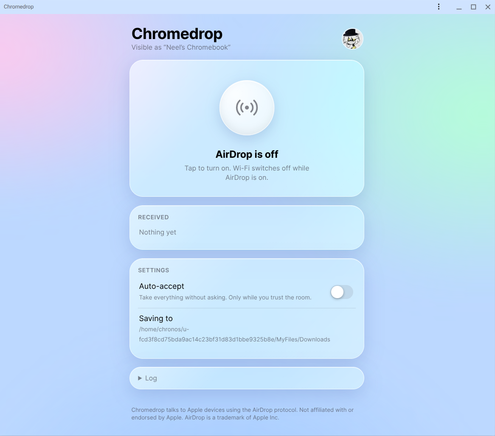
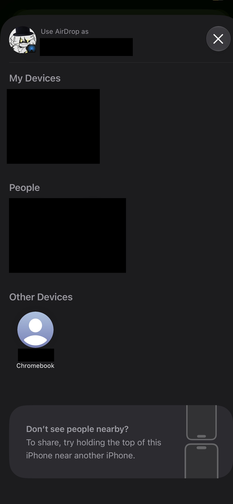
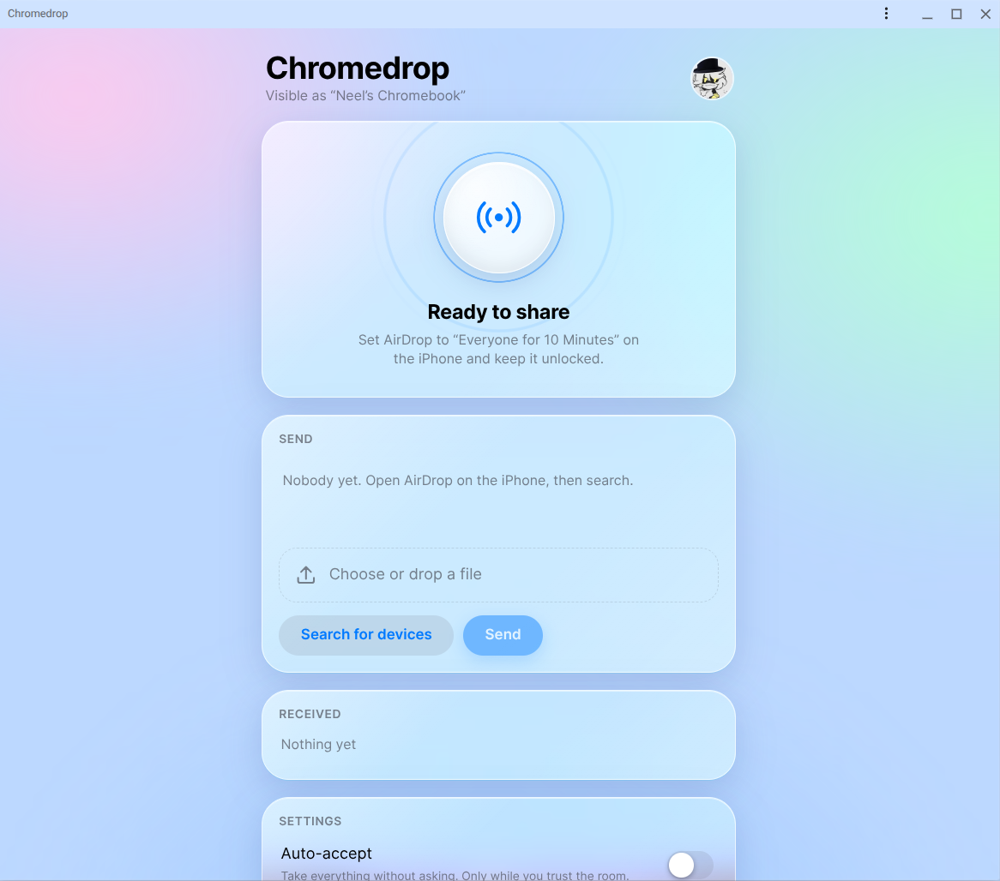

# chromedrop

| ChromeOS | iPhone |
| :--- | :---: |
|  |  |

AirDrop on ChromeOS! 
A thin installer + local web UI (installable PWA) around [Owly](https://github.com/t4t5/owly).

## How it works

1. Chrome PWA (on your device it's http://localhost:8780).
2. The PWA communicates with a root process (via Upstart): `chromedrop-web`.
3. This communicates with [owly](https://github.com/t4t5/owly) & owlyd.
4. Owly creates an awdl0 socket and sets up the AirDrop protocol,
5. and that communicates with your iPhone/iPad/Mac.

## Requirements

- x86_64 Chromebook with an Intel `iwlwifi` card (or see Owly's [supported hardware](https://github.com/t4t5/owly#supported-hardware)) and **developer mode on** (enabling it wipes the device, so be careful!).

## Install

1. In Chrome press Ctrl+Alt+T, type `shell`, then: `curl -fsSL https://raw.githubusercontent.com/NellowTCS/chromedrop/main/install.sh -o /tmp/i.sh` (`i.sh` to make it easier to type in VT-2)
2. Press Ctrl+Alt+F2 (VT-2), log in as `chronos`, run `sudo bash /tmp/i.sh`.
3. If it says **REBOOT**, reboot as it requires disabling rootfs (Ctrl+D at the verification screen) and run step 2 again.
4. Back in Chrome (Ctrl+Alt+F1) open `http://localhost:8780` and click the install icon in the address bar.

**Re-run the installer after every ChromeOS update** as updates overwrite `/etc`!

## Use

Turn AirDrop on, set the Apple device to **Everyone for 10 minutes**, and send (from app or from your device).
You can also share to it: in the Files app, right-click a file, choose **Share**, and pick Chromedrop (it must be installed as an app). The files wait in Chromedrop until you turn AirDrop on and pick a device. You can send several files at once (up to 50): they go as a single transfer, so the Apple device asks once. Accept/decline appears in the app.
While AirDrop is on Wi-Fi is off (at least for Intel cards, which run in Exclusive mode) so turning it off brings Wi-Fi back.
Files go in your ChromeOS `Downloads`. Keep the app window open (minimised is fine) to get notifications. Theoretically I could support (non-Web Push) push notifications via the local server... I'll add it in a bit.

## Name and picture
Apple devices show the name from your Google account, read from Chrome's profile. (Set `DEVICE_NAME=` in `/etc/chromedrop.conf` to override it) 
The AirDrop protocol has no way to send a profile picture to an Apple Device in Everyone mode unfortunately, so your picture only appears in this app.

## Notes
- Transfers are slow (channel 6, ~4-5 s per photo) on the Chromebook I have so YMMV!
- The service runs as root and binds only to `127.0.0.1`. It rejects other `Host`/`Origin` headers and requires an `X-Chromedrop` header on POSTs.
- Sending parses `owly browse` output heuristically; if your device list looks odd, type the device name.
- `polkit-stub/` is optional: it lets plain `owly ...` run as `chronos` in crosh. Tag a release (`v0.1.0`) and CI builds `polkit-stub-x86_64`, which the installer downloads. The web UI runs as root and doesn't need it.
- Uninstall: `sudo bash uninstall.sh` (rootfs verification stays off).
